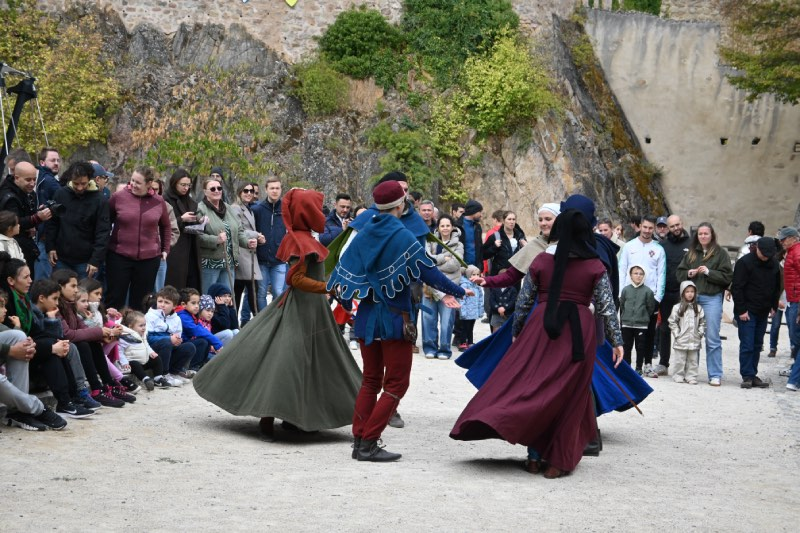
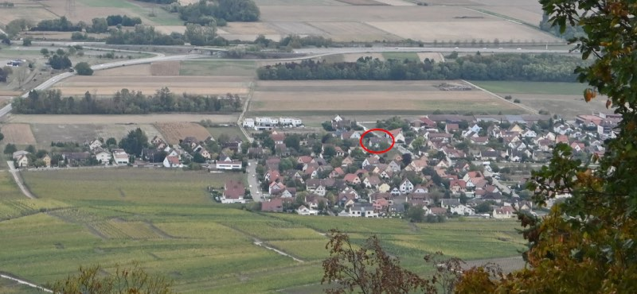
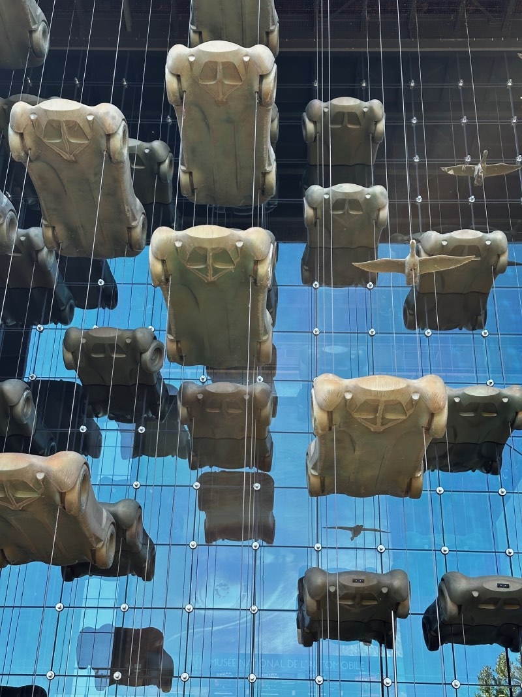

A whole month has gone by since I last wrote a blog post. I'm not sure if that's a reflection of life here becoming very normal, me being very lazy (most likely) or being too busy.

It's a trend for pensioners to claim how busy they are, but in truth there's still a measure of amazement that we get to do what we like every day, and someone gives us money anyway once a month. Busy? Perhaps, but more because we choose to do things rather than have it forced upon us, or squeezing it into a weekend.

Another potential factor in my lack of application to this blog has been my realisation that trying to watch YouTube while you wash up by having the laptop too close to the sink has consequences, namely wet hands and technology not mixing well. As a result I'm a few keys down on the keyboard, but these work when using a Bluetooth keyboard (as I'm doing right now). Maybe it will be like bits of me that are improving over time?

## Health update
Talking of how I'm doing, it's worth a quick recap.

My focus on regular - and longer - walks seems to be paying off. In my last post, I'd hit a 12k steps/day record, which has since been eclipsed by 17k steps on at least 2 days. I've walked to Colmar (7km), to the shops in Wintzenheim and back (7km) along with walking hiking routes in the Vosges mountains in Markstein (5.2km) and in Sainte Gertrude (4.3km).

Another benefit has been my ability to now sit like a normal person. Previously I could only manage 15 mins in a car seat, or a few minutes on a bench or hard surface. But that is now a thing of the past as I seem to be able to sit on any 'normal' seat for as long as I want to. This has been great as we've been able to travel further afield in the car and by train, but also to start planning day and overnight trips.

I had my second (self-administered!) Nanobot injection a couple of weeks ago, but I can't honestly say this has been reflected in a huge upturn in improvements. As I had been maintaining my use of anti-inflammatory drugs prior to this I suspect it has been masking the reality of where I actually am on the improvement curve. More recently I've shifted to reducing these drugs to one tablet every 2 or 3 days (instead of 2 a day) to start weaning myself off them.

### Health Insurance
The three-month milestone of being resident here has meant that we could finally apply to *l'Assurance Maladie* for state funding of our health costs. This means that any health charges we clock up from the date of application can be claimed back, although we are stuck arguing with our own insurance company for all the costs we accrued before then.

Rachel had done an excellent job assembling a document dossier for each of us to take to the (very informal) interview in Colmar. I have to say that I'm a bit of a fan of the French approach to having a real person look over your documents ahead of them being submitted, as it can catch the odd thing that could delay approval at the earliest opportunity.

Unfortunately, getting hold of the much-desired [Carte Vitale](https://www.ameli.fr/assure/remboursements/etre-bien-rembourse/carte-vitale/carte-vitale-application/carte-vitale) could still take some months, as confirmed by the guy who interviewed us. So the meticulous record keeping of our medical costs continues.

But we may have had some positive news on the hospital costs front. For months I've been sweating over the potential costs of my 5-night stay with all its associated tests, and carving out some provision for it in our financial plans. Today we received a statement for the costs of the stay, requesting a (non-state funding) contribution of just over €1,000 which is amazing if we can keep it to this. But looking over the invoice it suggests that the maximum (complete) charge could be just under €5,000 in total.

Our strategy is to still contest with our own insurance having to pay for ANYTHING as that's why we took out health insurance. My personal view is I doubt they'll do the decent thing and we'll end up sucking up the costs on the statement, but it's worth a try.

## Rachel's trip to the UK
Such was Rachel's confidence in my recovery, and my ability to now cover off the basics such as actually feeding myself, that she promptly got on a train and escaped to the UK for a family visit.

Our older neighbour, Alice, thankfully took pity on me and diverted one of her delivered meals to me to keep me alive a little longer. Unfortunately, this contain large chunks of meat, but I managed to salvage the rest of it.

Of course, full preparation for me having a supply of food had been undertaken in advance. It should be emphasized here that this did NOT include my ravenous appetite for all things unhealthy, so by the time she came back all the crisps, chocolate, biscuits and madeleines had gone.

The opportunity of a UK food run as part of this visit was considered, but having adjusted to food here we realised that we needed very little. My favourite [China Blend tea from Cardews](https://cardewoxford.co.uk/collections/cardew-blends/products/china-blend?variant=9414147866668) was top of the list, but things like Branston Pickle felt like sacrilege given the quality of cheese over here, and ketchup a forgotten condiment.

## Finances
We've been messing around with various financial advisers for a while now, but thought we had hit upon the right ones for us [back in July](https://www.ox1digital.co.uk/france/2026/07/11/3-days-to-go). This all came to a screeching halt in late September as it became clear that there were more costs associated with this than perhaps we'd understood there to be, which could have landed us with an £8,000 bill for setting up an Assurance Vie with associated ongoing financial advice.

With the house sale falling through, and the (then) unknown potential cost of my hospital stay, this didn't feel like a prudent move, so we politely detached from them and decided to take things into our own hands.

To be honest, I've been looking at all this for so long that I pretty much familiarised myself with what we can do here, so coming up with a plan wasn't too hard for me.

### Assurance Vie(s)
After getting some advice from Gemini on how to source an Assurance Vie I found [a good comparison site](https://avenuedesinvestisseurs.fr/av-assurance-vie/les-meilleures-assurances-vie/) that essentially set out the best buy options we could pursue ourselves

I decided on splitting across two different policies; [Linxea Spirit 2](https://www.linxea.com/assurance-vie/linxea-spirit-2/) and [Lucya CNP](https://lucya.com/assurance-vie/lucya-cnp/landing-page-lucya-cnp/) which both have pretty low ongoing rates and flexibilities around how to invest within the 'wrapper' they provide. As we'd held off starting down this road it was nice to be greeted with an improved bonus rate for investing a proportion in *Fonds en euros* when we came back to them.

We can also increase (or risk) our gains by being able to invest in ETFs within the 'wrapper' too. This is exactly how we used our Stocks & Shares ISAs, so we know a bit about this too, but we'll keep the proportion low to minimise any risks.

These schemes are really for our longer term savings, as letting them sit for at least 8 years means you can fully benefit from their tax-free aspects. So we needed some easy access options too.

### Easy Access funds
Because we're still finding our feet in terms of what we spend month-to-month, we wanted to keep a good amount of cash readily available, but still earning some interest at the same time.

Normal bank savings schemes provide a pretty low return *and* have tax taken from their gains, so we've taken advantage of the available tax-free options within our bank to set up two [*Livret A* accounts](https://www.my-french-house.com/blog/article/75397/whats-livret-in-france) and two LDDS (or [*Livret de développement durable et solidaire*](https://www.service-public.gouv.fr/particuliers/vosdroits/F2368?lang=en&first_article=livret-a-ldds-livret-helios&landing_page=moyens-de-paiement/qu-est-ce-que-le-paiement-mobile)) accounts. These are the best available equivalent to the UK ISAs here in France.

A recent chat with a Brit who has spent far longer in France, and is hawkish when it comes to saving on paying tax, revealed he's maximised the use of these savings plans. So it feels like this is the right move too, despite their dismal interest rate.

## Events and trips
There's still been plenty to do here as Autumn takes hold, and now my range has improved it means we've been able to go further afield.

### Château du Hohlandsbourg

Although fairly close to us, we visited [Hohlandsbourg Castle](https://www.chateau-hohlandsbourg.com) as part of the Collectivité Européenne d’Alsace celebrations of [their 5th anniversary](https://5ans-alsace.eu) as we'd not made it up there before now.

The castle is perched at the very top of the Vosges hills near us, so it has an outstanding view of Colmar and its surrounding villages, including Eguisheim. In fact, you *could* see our house from there!

There were medieval fight re-enactments, medieval dancing for all to join in with, as well as the usual learning centre stuff. Climbing the steps to the ramparts was a step too much for me so I took pleasure in watching the kids in their supervised medieval fights. Much violence and crying ensued, but no deaths.

### Mulhouse; Musée National de l'Automobile
Again, Mulhouse isn't too far from us, but a trip to their motor museum when my friend Tim visited had to be passed up back then. We were both keen to see this (as well as make a quick stop to Ikea too).

As well as having the largest collection of Bugattis possible, there was a temporary Grand Prix exhibit which gave me a great opportunity to try out some photography, as well as mansplain to Rachel the meagre information I actually know about Formula One.

[Photos here](https://photos.ox1digital.co.uk/alsace/musée-national-de-lautomobile)

### Solo trip to Strasbourg
This was my first real test of independence with Rachel away in the UK; finding my way to and around Strasbourg.

Having mucked up the (already minimal) Eguisheim bus timetable I took a 2.5km walk to an alternative bus stop to get me to Colmar and catch the train. Using my Carte Fluo discount card meant I got a 50% discount on the train fare, so it was a cheap trip.

As we'd [spent some time in Strasbourg already](https://www.ox1digital.co.uk/france/2026/03/21/location-scouting) we'd already done many of the main sights, so I decided to go to the Museum of Modern and Contemporary Art. I was immediately blown away by the building's design and the exhibits were right up my street.

I *think* I was flattered to be asked my age and then get a discount on entry? I was also pleased they had a good attitude to photography so I took advantage of that.

[Photos here](https://photos.ox1digital.co.uk/alsace/strasbourg-museum-of-modern-and-contemporary-art)

The rest of the day was mostly walking around and taking in the sights of Petite France before getting a bit too cold and tired, so headed home, magnificently coordinating train and bus timetables to get back quickly.

### Day trip to Basel

Deciding spontaneously just to go to Switzerland is really at the heart of the kind of life we wanted to carve out for ourselves here in Alsace, taking advantage of its central location in Europe. And at last we managed to achieve it this month.

It really felt...other. This wasn't France, although very close to its border, and the German influence was very strong. It was also a beautiful city to visit, with riverside walks, a fantastic tram network and an Autumn Fair in full swing that day.

Somehow I managed to hold myself back from gorging on Bratwurst. In fact, we had been prudent in bringing a picnic given the insane price of food in the city. Regrettably, as we hadn't anticipated the temperature drop between Eguisheim and Basel, we both ended up pretty cold, so had to stop off for a bit of winter wear shopping. I finally managed to get myself a Big French Scarf!

## Social events

### Englisheim
I've mentioned Englisheim Fridays previously, put on by our friends at Timothy's Microbrewery, and we've started to make this a regular social event.

The number of people turning up is increasing, partly because of a contingent of Colmar attendees. Having seen them a few times now, we're starting to form some nice friendships. For us this is really useful as the others have been here longer than us so can offer some useful tips.

### Taco lunch with 'The Americans'
At a previous Englisheim we met Teri and Matt, who had recently moved to Eguisheim. Rachel had dropped round to their house to let them have details of French classes in Colmar, and this gave rise to an invite to a lunch, which happened to coincide with Rachel's trip to the UK. So I decided to attend on my own.

They are an interesting bunch of people, each with a French spouse, but much younger (and with kids) than our Englisheim friends. But it felt clear that as younger, working people with children they have lots in common with each other.

Nevertheless, it was a lovely lunch with great conversation, lots around work! I was somewhat proud that I had so put work out of my mind that I couldn't remember the name of my last employer!
